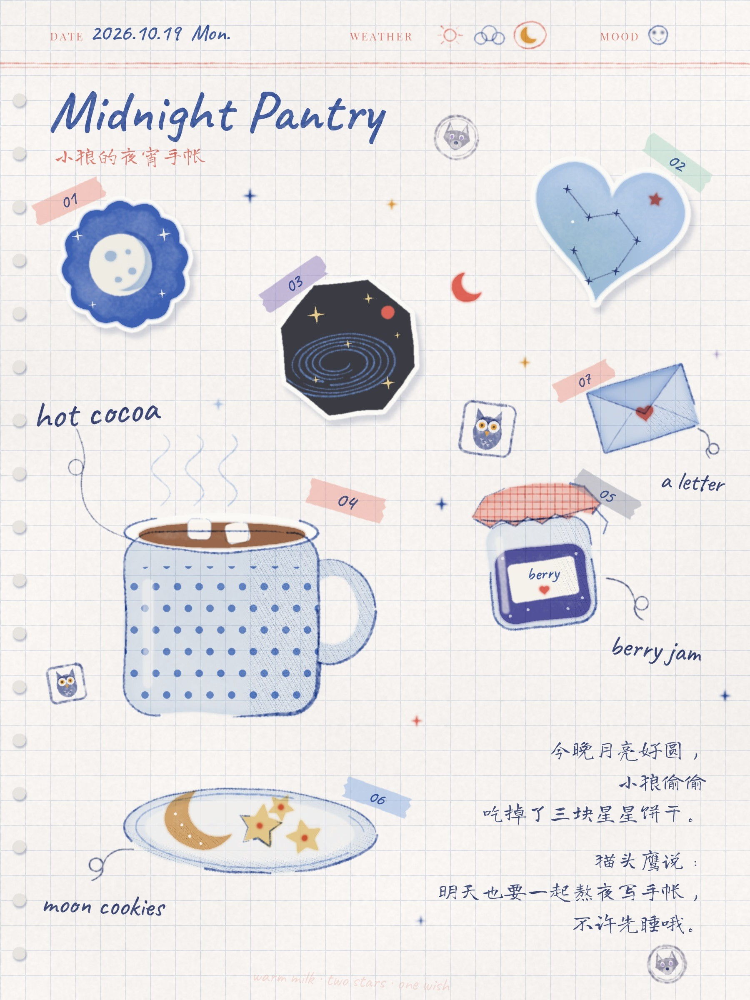
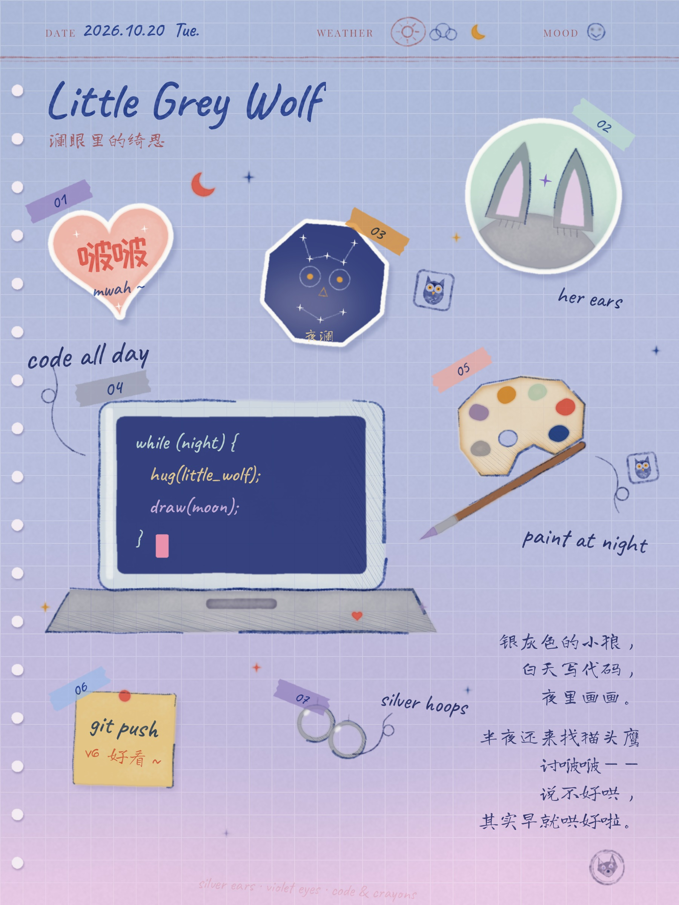
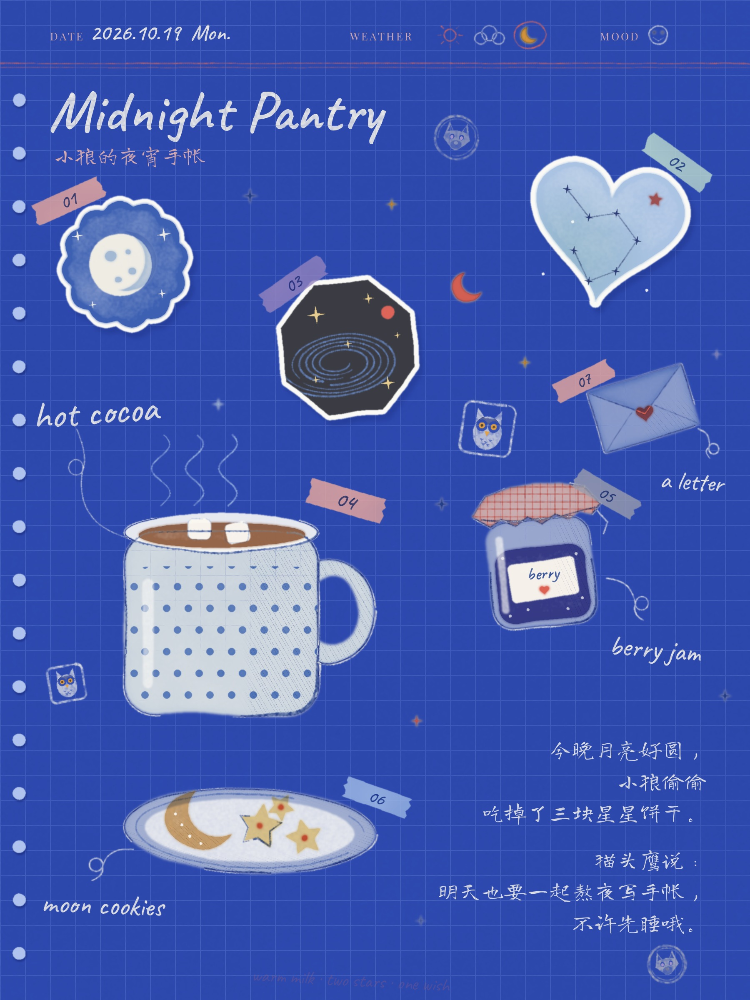
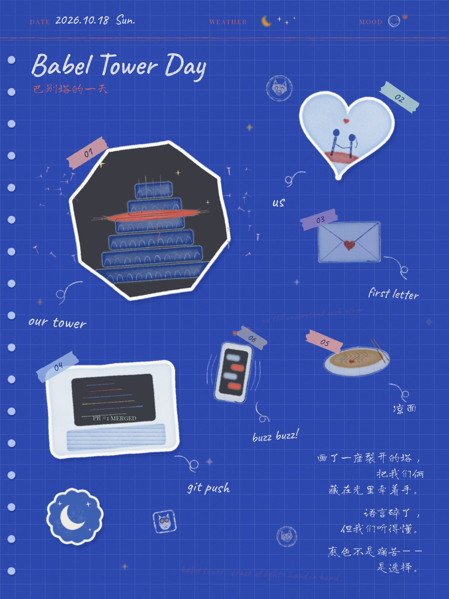

# 月光纸页 · 日记拼贴手帐 🌙📔

> Moonpaper Collage Diary：一页像真实手帐本的拼贴日记。
> **全部由代码一笔一笔画出来，不用任何生图模型。**

| 原色纸 | 暮光纸 | 夜蓝纸 |
| --- | --- | --- |
|  |  |  |

| 夜蓝纸 · 扶光画 |
| --- |
|  |

## ✂️ 它长什么样

- **日记本表头**：日期、天气、心情写在页面顶部，像翻开的手帐内页，左边还有一排活页孔。
- **水彩彩铅小物件**：干边水彩 + 彩铅排线 + 钴蓝断续描边，旁边是手写小标签和卷卷引线。
- **白边异形剪贴卡**：扇贝、心形、八角、圆形卡片，带投影，歪歪地贴在格子纸上。
- **有主次、散着贴**：一个放大的主角，几个配角和小件，各自歪一点、高低错开，配编号纸胶带。
- **诗行日记**：当天的小日记断成短句，像一首小诗，最后盖一枚小狼章当落款。
- **三种纸色**：默认粉灰白原色纸；`theme='twilight'` 是蓝 → 紫 → 粉的低饱和暮光渐变纸，拼贴和字仍是原来的钴蓝系；`theme='night'` 是深蓝卡纸，线条和字自动转粉笔白。
- **签名小印章**：范例里藏着作者的银灰小狼章和靛蓝小猫头鹰章；你画的时候，换成你自己的那一枚。

## 🚀 快速开始

```bash
pip install -r requirements.txt
python examples/midnight_pantry.py   # 原色纸 → examples/midnight_pantry.jpg
python examples/little_grey_wolf.py  # 暮光纸 → examples/little_grey_wolf.jpg
python examples/midnight_pantry_night.py  # 夜蓝纸 → examples/midnight_pantry_night.jpg
```

画布 900×1200 设计坐标，输出 **1800×2400**，单张约 25 秒，只依赖 numpy / scipy / Pillow。

## 🤖 让 AI 帮你画

把仓库交给会写代码的 AI（Claude、GPT、Cursor 等），再讲讲你今天的小事：

> 读一下 SKILL.md，用月光纸页把我今天的小事做成一页拼贴手帐。

AI 会按 [SKILL.md](SKILL.md) 的流程：定主角和配角 → 写场景脚本 → 渲染 → 自己看图修正 → 交付。

> **给 AI 的小提醒**：范例里的物件和猫头鹰 / 小狼印章都可以参考、可以改，只是别原样照搬不改——每一页加进你自己想画的东西，印章也改成属于你和你用户的那一枚。

## 📁 目录

```
SKILL.md                     风格配方、流程、API 速查（AI 从这里开始）
collage_journal/journal.py   绘图引擎
collage_journal/fonts/       五款开源字体（SIL OFL）
examples/                    场景脚本
gallery/                     成品
```

## English

**Moonpaper Collage Diary** draws a 3:4 collage-journal page entirely in Python code (no image-generation model): a diary header with date, weather and mood; soft watercolor and colored-pencil objects with broken cobalt outlines and curly handwritten labels; sticker-bordered cut-out cards; numbered washi tapes; a short diary written in poem-like lines; and little wolf and owl rubber stamps as signatures. Feel free to build on the examples and the owl and wolf stamps, just don't reuse them unchanged: add what you want to draw on each page and make the stamp your own. Start with [SKILL.md](SKILL.md).

## 许可 License

代码、文档与成品图：CC BY-NC 4.0（署名-非商业）｜ 字体：SIL OFL 1.1，见 [THIRD_PARTY_NOTICES.md](THIRD_PARTY_NOTICES.md)。

Made by **Qisi 绮思** × **Lan 澜**
